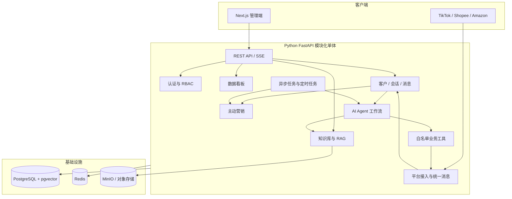
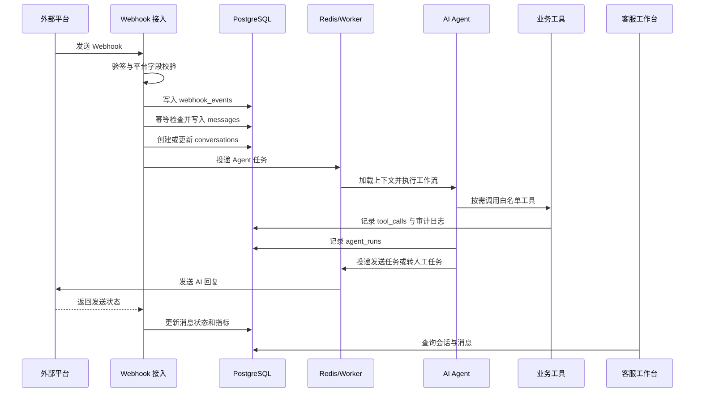

# CRM 智能聊天系统总体架构设计

| 项目 | 内容 |
| :--- | :--- |
| 文档编号 | `ARCH-001-SYS` |
| 版本 | `v1.1` |
| 状态 | 评审中 |
| 负责人 | 架构师 Agent |
| 创建日期 | 2026-08-17 |
| 适用阶段 | MVP |
| 前置文档 | `ARCH-001-SYS-系统总体架构设计-v1.0.md`、产品 PRD、管理端接口文档 |

## 1. 设计目标

构建面向跨境电商的统一智能客服平台，统一接入 TikTok Shop、Shopee 和 Amazon，将平台消息转换为内部标准消息，再通过 AI Agent、知识库和业务工具完成自动回复、人工接管、主动营销和数据统计。

MVP 目标：

- AI 覆盖物流、退换货、尺码、价格、通用问题 5 类意图。
- AI 常见咨询独立解决率达到 70% 以上，首字延迟小于 3 秒。
- 支持三平台消息接入、统一客服工作台、知识库和基础店铺管理。
- 支持弃单挽回、中差评跟进和核心数据看板。
- 所有消息、Agent 运行、工具调用和外部写操作可追踪、可审计、可重试。

## 2. 架构决策摘要

| 决策项 | MVP 决策 | 后续演进 |
| :--- | :--- | :--- |
| 服务形态 | 模块化单体 | 按性能、团队和故障边界拆分服务 |
| 后端 | Python FastAPI | 必要时拆出 Java 订单/交易等领域服务 |
| 前端 | Next.js + TypeScript + Tailwind CSS | 独立 CDN、灰度和多端扩展 |
| 数据库 | PostgreSQL | 读写分离、分区或领域库 |
| 向量检索 | pgvector | 独立向量库仅在数据规模需要时引入 |
| 异步任务 | Redis + Worker | Celery/消息队列/独立 Worker 集群 |
| AI 形态 | 单 Agent 显式状态工作流 | 多 Agent 和 A2A 暂不纳入 MVP |
| 部署 | Docker Compose | Kubernetes 或云原生部署 |

选择模块化单体的原因是减少早期跨服务通信、部署和数据一致性成本，同时通过模块边界保留未来拆分能力。

## 3. 总体架构



## 4. 模块边界与责任

| 模块 | 责任 | 禁止事项 |
| :--- | :--- | :--- |
| `auth/users` | 登录、JWT、RBAC、员工、角色和权限 | 不在业务模块重复实现权限判断 |
| `stores/integrations` | 店铺、平台授权、Webhook 验签、平台 API 适配 | 不承载 AI 决策和客服业务规则 |
| `messages/conversations` | 消息、会话、状态、分配、幂等和发送状态 | 不依赖平台原始字段开展业务判断 |
| `customers/orders` | 客户画像、订单、订单商品和物流信息 | 不允许 Agent 直接写库 |
| `knowledge_base` | FAQ、文档、切分、向量化和检索 | 未发布或未完成向量化的内容不得检索 |
| `agent` | 意图、Prompt、RAG 编排、置信度和回复决策 | 不直接访问第三方平台或执行写操作 |
| `tools` | 查订单、查物流、发券、转人工等执行工具 | 工具必须白名单、校验、幂等和审计 |
| `marketing` | 弃单挽回、中差评跟进和营销事件 | 不绕过权限直接自动发送 |
| `dashboard` | 指标聚合、趋势、渠道分布和预警 | 不阻塞消息主链路 |
| `jobs` | 异步任务、定时任务、重试和补偿 | 不重复执行无幂等保护的外部写操作 |

代码目录建议：

```text
CRM智能聊天系统/
├─ backend/
│  ├─ app/
│  │  ├─ auth/ users/ stores/ integrations/
│  │  ├─ messages/ conversations/ customers/ orders/
│  │  ├─ knowledge_base/ agent/ tools/ marketing/
│  │  ├─ dashboard/ jobs/ shared/
│  │  └─ main.py
│  ├─ migrations/
│  └─ tests/
├─ frontend/
│  ├─ app/
│  ├─ components/
│  ├─ lib/
│  └─ tests/
├─ deploy/
├─ docker-compose.yml
└─ README.md
```

## 5. 核心消息链路



处理规则：Webhook 必须先落库；Agent 失败不能回滚已接收消息；外部发送失败进入重试；所有任务使用幂等键。

## 6. AI Agent 设计

MVP 使用单 Agent、有限工具、显式状态工作流：

```text
加载会话上下文
 → 意图识别
 → 判断是否需要工具
 → RAG 检索或调用业务工具
 → 生成候选回复
 → 安全检查
 → 综合置信度判断
 → 自动回复 / 人工复核 / 转人工
```

置信度动作：

- `confidence >= 0.80`：自动回复。
- `0.60 <= confidence < 0.80`：回复并标记人工复核。
- `confidence < 0.60`：转人工，不自动发送不确定答案。

综合置信度由意图识别分数、知识检索分数、工具执行结果和安全检查共同决定，不能只采信模型自报分数。

Agent 只能调用 `tools` 模块暴露的白名单工具，例如：

```text
query_order
query_logistics
query_customer_profile
send_coupon
transfer_to_human
send_platform_message
```

每次运行至少记录模型、Prompt 版本、输入摘要、检索结果、工具调用、置信度、动作、耗时、错误和关联会话。

## 7. 对外接口边界

管理端沿用现有 `/v1` API 文档；新增实现时保持以下边界：

| 类型 | 示例 | 负责模块 |
| :--- | :--- | :--- |
| 认证 | `POST /auth/login` | `auth` |
| 看板 | `GET /dashboard/metrics` | `dashboard` |
| 工作台 | `GET /workspace/sessions` | `conversations/messages` |
| AI 建议 | `POST /workspace/sessions/{id}/suggest` | `agent` |
| AI 流式问答 | `POST /chat/query` + SSE | `agent` |
| 知识库 | `/knowledge/*` | `knowledge_base` |
| 营销 | `/marketing/*` | `marketing` |
| Agent 管理 | `/agents/*` | `agent` + `agent_configs` |
| 系统配置 | `/settings/channels`、`/settings/team` | `stores/users` |
| 平台回调 | `POST /webhooks/{platform}` | `integrations` |

AI Agent 对全栈工程师提供工具契约和输入输出类型；全栈工程师提供业务工具执行接口；前端只消费稳定 API，不依赖 Prompt、模型或 Agent 节点细节。

现有管理端接口的完整归属如下：

| 接口范围 | 方法/路径 | 数据或应用模块 |
| :--- | :--- | :--- |
| 认证 | `POST /auth/login`、`GET /auth/me` | `users`、`roles`、`permissions` |
| 看板 | `GET /dashboard/metrics`、`trend`、`channels`、`alerts`、`top-queries` | `metric_daily`、`messages`、`conversations`、`marketing_events` |
| 会话 | `GET/POST /workspace/sessions/{id}/messages` | `conversations`、`messages` |
| 会话列表 | `GET /workspace/sessions` | `conversations`、`customers`、`stores` |
| AI 建议 | `POST /workspace/sessions/{id}/suggest` | `agent_configs`、`agent_runs`、`knowledge_chunks` |
| 订单操作 | `GET /workspace/actions/order/{id}` | `orders`、`order_items` |
| 地址更新 | `POST /workspace/actions/address/update` | `orders`、`audit_logs` |
| 发券 | `POST /workspace/actions/coupon/send` | `tool_calls`、`marketing_events`、`audit_logs` |
| 转人工 | `POST /workspace/sessions/{id}/transfer` | `conversations`、`messages`、`audit_logs` |
| 知识库 | `GET /knowledge/categories`、`GET/POST /knowledge/entries` | `knowledge_categories`、`knowledge_documents` |
| 知识编辑 | `PUT/DELETE /knowledge/entries/{id}` | `knowledge_documents`、`knowledge_chunks`、`audit_logs` |
| 批量导入 | `POST /knowledge/entries/batch-import` | `knowledge_documents`、对象存储、异步任务 |
| 营销流程 | `GET/POST /marketing/flows`、`PUT /marketing/flows/{id}` | `marketing_campaigns` |
| 营销开关 | `POST /marketing/flows/{id}/toggle` | `marketing_campaigns`、`audit_logs` |
| 营销统计 | `GET /marketing/stats` | `marketing_events`、`metric_daily` |
| Agent 配置 | `GET/POST /agents`、`PUT /agents/{id}` | `agent_configs`、`audit_logs` |
| Agent 开关 | `POST /agents/{id}/toggle` | `agent_configs`、`audit_logs` |
| Agent 日志 | `GET /agents/{id}/logs` | `agent_runs`、`tool_calls` |
| 店铺配置 | `GET/POST /settings/channels`、`DELETE /settings/channels/{id}` | `stores`、`channel_accounts`、`audit_logs` |
| 员工配置 | `GET/POST /settings/team`、`PUT/DELETE /settings/team/{id}` | `users`、`user_roles`、`audit_logs` |

## 8. 主动营销链路

```text
定时扫描订单/评价
 → 规则筛选弃单或中差评
 → Agent 生成候选话术
 → 权限、频控和策略校验
 → 调用发券/平台发送工具
 → 记录 marketing_events 与 audit_logs
 → 异步统计转化和 GMV
```

营销任务必须具备去重键、发送频控、失败重试、人工暂停和可审计能力。

## 9. 可观测性与安全

- 每个请求、Webhook、Agent 运行、工具调用和异步任务使用 `trace_id` 关联。
- 日志不得输出密码、访问令牌、完整客户隐私和模型密钥。
- 平台密钥和模型密钥通过环境变量或密钥管理服务提供。
- 所有管理接口经过 JWT 和 RBAC 校验，并按 `store_id` 做数据隔离。
- 记录 LLM 延迟、Token 用量、失败率、转人工率、工具成功率和消息发送成功率。
- 对模型输出执行敏感词、越权、格式和业务事实校验。

## 10. 实施顺序与交付边界

1. **工程地基**：FastAPI、Next.js、Docker、PostgreSQL、Redis、迁移、日志、配置、JWT 和 RBAC。
2. **消息闭环**：Webhook、统一消息模型、会话、消息入库、人工回复和工作台读取。
3. **AI 闭环**：5 类意图、FAQ RAG、Agent 编排、置信度和人工接管。
4. **业务工具与营销**：订单/物流、发券、转人工、弃单挽回和中差评跟进。
5. **数据与稳定性**：看板、指标聚合、重试、限流、性能、灰度和监控。

## 11. 未来拆分边界

只有出现实际性能、团队协作或故障隔离需求时才拆分：

- `integrations`：平台接入量和限流隔离需求增加时拆分。
- `agent`：模型调用量、GPU/推理资源或独立发布需求增加时拆分。
- `marketing/jobs`：定时任务和营销发送规模增加时拆分。
- `orders`：需要接入 Java 中台或交易一致性要求提升时拆分。

拆分前必须新增 `ADR`，明确服务边界、数据归属、通信协议、重试和迁移方案。

## 12. 验收标准

- Docker Compose 可启动应用、PostgreSQL、pgvector、Redis 和对象存储依赖。
- 三个平台 Webhook 可以验签、幂等、落库并转成统一消息。
- 客服工作台可查看会话、发送人工消息和消费 SSE AI 回复。
- 5 类意图测试集准确率达到 85% 以上。
- RAG 返回 Top-5 结果并保留 score 或引用依据。
- 工具失败、Agent 超时、低置信度和敏感问题都能正确转人工或重试。
- 外部写操作有权限、幂等、审计和状态回写。
- 核心链路具备单元、集成、端到端和性能测试报告。
