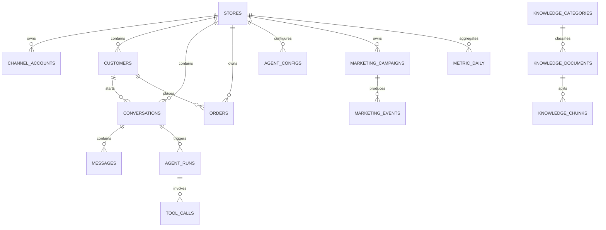

# CRM 智能聊天系统数据库与向量库初版设计

| 项目 | 内容 |
| :--- | :--- |
| 文档编号 | `ARCH-003-DATA` |
| 版本 | `v1.0` |
| 状态 | 评审中 |
| 负责人 | 架构师 Agent |
| 创建日期 | 2026-08-17 |
| 适用阶段 | MVP |
| 数据库 | PostgreSQL + pgvector |

> 本文件为 1536 维历史初版。当前数据库与向量库设计见 `ARCH-003-DATA-数据库与向量库初版设计-v1.1.md`，迁移 head 为 `014_bge_hybrid`，不得继续按本版本创建新的知识向量结构。

## 1. 设计原则

1. 所有业务数据都能追溯到 `store_id`，实现店铺级隔离。
2. 外部平台数据保留标准化字段和必要的 `raw_payload`，便于排错和重放。
3. Webhook 和消息先落库，再进入异步处理，避免丢失。
4. 外部写操作、Agent 运行、工具调用和状态变化必须可审计。
5. 业务时间统一使用 UTC `timestamptz`，展示层按用户时区转换。
6. 金额使用 `numeric(18,2)`，不使用浮点数。
7. MVP 使用 UUID 作为内部主键；平台 ID 只作为外部唯一键，不直接作为主键。
8. 软删除仅用于用户、店铺、知识文档等需要恢复的实体；消息、审计和 Webhook 记录默认不物理删除。

## 2. 数据域关系



## 3. 公共字段约定

除关联表和纯日志表外，核心实体统一包含：

```text
id           uuid primary key
store_id     uuid not null        -- 全局实体或系统配置可为空
created_at   timestamptz not null
updated_at   timestamptz not null
deleted_at   timestamptz null      -- 需要软删除的实体使用
```

建议使用数据库默认值：

```sql
created_at timestamptz NOT NULL DEFAULT now()
updated_at timestamptz NOT NULL DEFAULT now()
```

## 4. 认证与组织表

### 4.1 `users`

| 字段 | 类型 | 约束 | 说明 |
| :--- | :--- | :--- | :--- |
| `id` | uuid | PK | 用户 ID |
| `email` | varchar(255) | NOT NULL, UNIQUE | 登录邮箱 |
| `password_hash` | varchar(255) | NOT NULL | 密码哈希 |
| `name` | varchar(100) | NOT NULL | 姓名 |
| `avatar` | varchar(500) | NULL | 头像地址 |
| `status` | varchar(20) | NOT NULL | active/disabled |
| `last_login_at` | timestamptz | NULL | 最后登录时间 |
| `created_at/updated_at` | timestamptz | NOT NULL | 公共字段 |

### 4.2 `roles`、`permissions`

`roles`：`id`、`code`、`name`、`description`、`created_at`、`updated_at`。

`permissions`：`id`、`code`、`name`、`resource`、`action`、`created_at`。

约束：`roles.code`、`permissions.code` 唯一。

### 4.3 关联表

`user_roles(user_id, role_id, store_id, created_at)`：联合主键或唯一约束 `(user_id, role_id, store_id)`。

`role_permissions(role_id, permission_id, created_at)`：联合主键 `(role_id, permission_id)`。

当用户只属于系统级角色时 `store_id` 可为空；店铺级角色必须设置 `store_id`。

## 5. 店铺与平台表

### 5.1 `stores`

字段：

```text
id uuid PK
name varchar(200) NOT NULL
code varchar(100) NOT NULL
status varchar(20) NOT NULL       -- active/disabled
timezone varchar(50) NOT NULL DEFAULT 'UTC'
currency varchar(10) NOT NULL DEFAULT 'USD'
metadata jsonb NOT NULL DEFAULT '{}'
created_at timestamptz NOT NULL
updated_at timestamptz NOT NULL
deleted_at timestamptz NULL
```

唯一约束：`code`。

### 5.2 `channel_accounts`

字段：

```text
id uuid PK
store_id uuid NOT NULL FK stores(id)
platform varchar(30) NOT NULL    -- tiktok/shopee/amazon
external_store_id varchar(200) NOT NULL
display_name varchar(200) NOT NULL
access_token_ref varchar(500) NOT NULL   -- 密钥引用，不保存明文 Token
refresh_token_ref varchar(500) NULL
token_expires_at timestamptz NULL
status varchar(20) NOT NULL
scopes jsonb NOT NULL DEFAULT '[]'
last_sync_at timestamptz NULL
metadata jsonb NOT NULL DEFAULT '{}'
created_at timestamptz NOT NULL
updated_at timestamptz NOT NULL
```

唯一约束：`(platform, external_store_id)`。

## 6. 客户、会话与消息表

### 6.1 `customers`

字段：

```text
id uuid PK
store_id uuid NOT NULL FK stores(id)
platform varchar(30) NULL
external_customer_id varchar(200) NULL
name varchar(200) NULL
email varchar(255) NULL
phone varchar(50) NULL
avatar varchar(500) NULL
tags jsonb NOT NULL DEFAULT '[]'
order_count integer NOT NULL DEFAULT 0
total_spend numeric(18,2) NOT NULL DEFAULT 0
last_seen_at timestamptz NULL
metadata jsonb NOT NULL DEFAULT '{}'
created_at timestamptz NOT NULL
updated_at timestamptz NOT NULL
```

唯一约束：当平台和外部客户 ID 均存在时，`(store_id, platform, external_customer_id)` 唯一。

### 6.2 `conversations`

字段：

```text
id uuid PK
store_id uuid NOT NULL FK stores(id)
customer_id uuid NOT NULL FK customers(id)
platform varchar(30) NOT NULL
external_conversation_id varchar(200) NOT NULL
status varchar(20) NOT NULL      -- active/pending/transferred/resolved/closed
assigned_user_id uuid NULL FK users(id)
unread_count integer NOT NULL DEFAULT 0
last_message_id uuid NULL
last_message_at timestamptz NULL
transfer_reason varchar(500) NULL
metadata jsonb NOT NULL DEFAULT '{}'
created_at timestamptz NOT NULL
updated_at timestamptz NOT NULL
```

唯一约束：`(store_id, external_conversation_id)`。

### 6.3 `messages`

字段：

```text
id uuid PK
store_id uuid NOT NULL FK stores(id)
conversation_id uuid NOT NULL FK conversations(id)
customer_id uuid NULL FK customers(id)
platform varchar(30) NOT NULL
external_message_id varchar(200) NOT NULL
role varchar(20) NOT NULL       -- user/assistant/agent/system
direction varchar(20) NOT NULL  -- inbound/outbound
message_type varchar(30) NOT NULL DEFAULT 'text'
content text NOT NULL
language varchar(20) NULL
status varchar(20) NOT NULL      -- received/processing/sent/delivered/failed
agent_run_id uuid NULL
error_code varchar(100) NULL
sent_at timestamptz NULL
delivered_at timestamptz NULL
raw_payload jsonb NOT NULL DEFAULT '{}'
created_at timestamptz NOT NULL
updated_at timestamptz NOT NULL
```

唯一约束：`(platform, external_message_id)`；内部人工消息可使用系统生成的外部 ID。

索引：`(conversation_id, created_at)`、`(store_id, status, created_at)`。

## 7. 订单表

### 7.1 `orders`

字段：

```text
id uuid PK
store_id uuid NOT NULL FK stores(id)
customer_id uuid NULL FK customers(id)
platform varchar(30) NOT NULL
external_order_id varchar(200) NOT NULL
status varchar(30) NOT NULL
payment_status varchar(30) NULL
fulfillment_status varchar(30) NULL
currency varchar(10) NOT NULL
total_amount numeric(18,2) NOT NULL DEFAULT 0
shipping_address jsonb NULL
tracking_number varchar(200) NULL
tracking_status varchar(100) NULL
ordered_at timestamptz NULL
paid_at timestamptz NULL
shipped_at timestamptz NULL
delivered_at timestamptz NULL
raw_payload jsonb NOT NULL DEFAULT '{}'
created_at timestamptz NOT NULL
updated_at timestamptz NOT NULL
```

唯一约束：`(store_id, platform, external_order_id)`。

### 7.2 `order_items`

字段：`id`、`order_id`、`external_item_id`、`product_id`、`sku`、`product_name`、`quantity`、`unit_price`、`total_amount`、`raw_payload`、`created_at`。

约束：`order_id` 外键级联删除；金额使用 `numeric(18,2)`。

## 8. 知识库与向量表

### 8.1 `knowledge_categories`

字段：

```text
id uuid PK
store_id uuid NOT NULL FK stores(id)
name varchar(100) NOT NULL
code varchar(100) NOT NULL
sort_order integer NOT NULL DEFAULT 0
status varchar(20) NOT NULL DEFAULT 'active'
created_at timestamptz NOT NULL
updated_at timestamptz NOT NULL
```

唯一约束：`(store_id, code)`。知识文档通过 `category_id` 关联分类。

### 8.2 `knowledge_documents`

字段：

```text
id uuid PK
store_id uuid NOT NULL FK stores(id)
category varchar(100) NOT NULL
title varchar(300) NOT NULL
question text NULL
answer text NULL
source_type varchar(30) NOT NULL DEFAULT 'faq'
category_id uuid NOT NULL FK knowledge_categories(id)
source_uri varchar(1000) NULL
status varchar(20) NOT NULL    -- draft/published/archived
version integer NOT NULL DEFAULT 1
content_hash varchar(128) NULL
published_at timestamptz NULL
created_by uuid NULL FK users(id)
created_at timestamptz NOT NULL
updated_at timestamptz NOT NULL
deleted_at timestamptz NULL
```

MVP `source_type=faq`，`question` 和 `answer` 必填；发布后异步生成 chunks。

### 8.3 `knowledge_chunks`

字段：

```text
id uuid PK
document_id uuid NOT NULL FK knowledge_documents(id)
store_id uuid NOT NULL FK stores(id)
chunk_index integer NOT NULL
content text NOT NULL
token_count integer NULL
embedding vector(1536) NOT NULL
metadata jsonb NOT NULL DEFAULT '{}'
created_at timestamptz NOT NULL
```

约束：`(document_id, chunk_index)` 唯一。

索引示例：

```sql
CREATE INDEX idx_knowledge_chunks_embedding
ON knowledge_chunks USING ivfflat (embedding vector_cosine_ops)
WITH (lists = 100);
```

实际维度必须与所选 Embedding 模型一致；模型变更时增加版本或重建索引，不允许混用不同维度。

## 9. Agent、工具与审计表

### 9.1 `agent_configs`

字段：

```text
id uuid PK
store_id uuid NOT NULL FK stores(id)
name varchar(200) NOT NULL
code varchar(100) NOT NULL
description varchar(1000) NULL
status varchar(20) NOT NULL DEFAULT 'disabled'
model_provider varchar(50) NOT NULL
model_name varchar(100) NOT NULL
system_prompt text NOT NULL
prompt_version varchar(100) NOT NULL
temperature numeric(3,2) NOT NULL DEFAULT 0.2
confidence_high numeric(5,4) NOT NULL DEFAULT 0.8000
confidence_low numeric(5,4) NOT NULL DEFAULT 0.6000
enabled_tools jsonb NOT NULL DEFAULT '[]'
knowledge_scope jsonb NOT NULL DEFAULT '{}'
config jsonb NOT NULL DEFAULT '{}'
created_by uuid NULL FK users(id)
created_at timestamptz NOT NULL
updated_at timestamptz NOT NULL
```

唯一约束：`(store_id, code)`。模型密钥只保存引用，不保存明文；Prompt 更新必须递增 `prompt_version`。

### 9.2 `agent_runs`

字段：

```text
id uuid PK
store_id uuid NOT NULL FK stores(id)
conversation_id uuid NOT NULL FK conversations(id)
trigger_message_id uuid NULL FK messages(id)
model_provider varchar(50) NOT NULL
model_name varchar(100) NOT NULL
prompt_version varchar(100) NULL
intent varchar(100) NULL
intent_confidence numeric(5,4) NULL
retrieval_score numeric(5,4) NULL
final_confidence numeric(5,4) NULL
action varchar(30) NOT NULL    -- auto_reply/human_review/transfer_human/failed
status varchar(20) NOT NULL     -- running/succeeded/failed/timeout
input_summary text NULL
output_summary text NULL
error_code varchar(100) NULL
latency_ms integer NULL
input_tokens integer NULL
output_tokens integer NULL
trace_id varchar(100) NULL
created_at timestamptz NOT NULL
updated_at timestamptz NOT NULL
```

### 9.3 `tool_calls`

字段：

```text
id uuid PK
store_id uuid NOT NULL FK stores(id)
agent_run_id uuid NOT NULL FK agent_runs(id)
tool_name varchar(100) NOT NULL
idempotency_key varchar(200) NOT NULL
status varchar(20) NOT NULL   -- pending/running/succeeded/failed/timeout
input_payload jsonb NOT NULL DEFAULT '{}'
output_payload jsonb NULL
error_code varchar(100) NULL
retry_count integer NOT NULL DEFAULT 0
started_at timestamptz NULL
finished_at timestamptz NULL
created_at timestamptz NOT NULL
```

唯一约束：`(store_id, idempotency_key)`。

### 9.4 `audit_logs`

字段：`id`、`store_id`、`actor_type`、`actor_id`、`action`、`resource_type`、`resource_id`、`request_id`、`before_data`、`after_data`、`result`、`ip_address`、`created_at`。

审计日志只追加，不更新、不软删除。

## 10. 营销与指标表

### 10.1 `marketing_campaigns`

字段：

```text
id uuid PK
store_id uuid NOT NULL FK stores(id)
type varchar(30) NOT NULL        -- abandoned_cart/bad_review/logistics
name varchar(200) NOT NULL
status varchar(20) NOT NULL      -- draft/active/paused/finished
rules jsonb NOT NULL DEFAULT '{}'
prompt_version varchar(100) NULL
frequency_limit jsonb NOT NULL DEFAULT '{}'
created_by uuid NULL FK users(id)
created_at timestamptz NOT NULL
updated_at timestamptz NOT NULL
```

### 10.2 `marketing_events`

字段：`id`、`store_id`、`campaign_id`、`customer_id`、`order_id`、`conversation_id`、`event_type`、`status`、`dedup_key`、`coupon_code`、`message_id`、`recovered_amount`、`error_code`、`triggered_at`、`created_at`。

唯一约束：`(store_id, dedup_key)`，防止同一事件重复触达。

### 10.3 `metric_daily`

字段：

```text
id uuid PK
store_id uuid NOT NULL FK stores(id)
metric_date date NOT NULL
session_count integer NOT NULL DEFAULT 0
message_count integer NOT NULL DEFAULT 0
ai_reply_count integer NOT NULL DEFAULT 0
transfer_count integer NOT NULL DEFAULT 0
transfer_rate numeric(7,4) NOT NULL DEFAULT 0
avg_response_ms integer NULL
recovered_gmv numeric(18,2) NOT NULL DEFAULT 0
channel_breakdown jsonb NOT NULL DEFAULT '{}'
created_at timestamptz NOT NULL
updated_at timestamptz NOT NULL
```

唯一约束：`(store_id, metric_date)`。

## 11. Webhook 表

### `webhook_events`

字段：

```text
id uuid PK
platform varchar(30) NOT NULL
channel_account_id uuid NULL FK channel_accounts(id)
external_event_id varchar(200) NOT NULL
event_type varchar(100) NOT NULL
signature_valid boolean NOT NULL DEFAULT false
payload_hash varchar(128) NOT NULL
raw_payload jsonb NOT NULL
status varchar(20) NOT NULL    -- received/processing/succeeded/failed/ignored
error_code varchar(100) NULL
retry_count integer NOT NULL DEFAULT 0
received_at timestamptz NOT NULL
processed_at timestamptz NULL
created_at timestamptz NOT NULL
updated_at timestamptz NOT NULL
```

唯一约束：`(platform, external_event_id)`；无外部事件 ID 时使用 `payload_hash + received_at` 的去重策略。

## 12. 状态枚举

```text
conversation.status:
active | pending | transferred | resolved | closed

message.role:
user | assistant | agent | system

message.status:
received | processing | sent | delivered | failed

agent_runs.action:
auto_reply | human_review | transfer_human | failed

knowledge_documents.status:
draft | published | archived

tool_calls.status:
pending | running | succeeded | failed | timeout

webhook_events.status:
received | processing | succeeded | failed | ignored
```

状态流转必须由应用服务集中管理，不允许控制器或前端直接写任意状态。

## 13. 索引与隔离

至少创建：

```sql
CREATE INDEX idx_messages_conversation_created
ON messages (conversation_id, created_at DESC);

CREATE INDEX idx_conversations_store_status_updated
ON conversations (store_id, status, updated_at DESC);

CREATE INDEX idx_conversations_store_unread
ON conversations (store_id, unread_count)
WHERE unread_count > 0;

CREATE INDEX idx_orders_store_external
ON orders (store_id, external_order_id);

CREATE INDEX idx_agent_runs_conversation_created
ON agent_runs (conversation_id, created_at DESC);

CREATE INDEX idx_tool_calls_agent_created
ON tool_calls (agent_run_id, created_at DESC);

CREATE UNIQUE INDEX uq_metric_daily_store_date
ON metric_daily (store_id, metric_date);

CREATE UNIQUE INDEX uq_webhook_platform_event
ON webhook_events (platform, external_event_id);
```

应用层所有查询必须从认证上下文取得 `store_id`，禁止从普通请求参数直接信任店铺 ID。后续可增加 PostgreSQL Row Level Security，但 MVP 先通过 Repository/Service 层统一注入和校验。

## 14. 事务与数据流规则

### Webhook 接收

1. 验签并计算 `payload_hash`。
2. 在 `webhook_events` 中按 `(platform, external_event_id)` 幂等写入。
3. 事务提交后异步标准化消息。
4. 标准化消息写入 `messages`，创建或更新 `conversations`。
5. 投递 Agent 或同步任务；失败只更新状态并增加重试次数。

### Agent 处理

1. 读取会话最近消息和店铺知识范围。
2. 创建 `agent_runs(status=running)`。
3. 执行意图、检索和工具调用；每次工具调用独立写入 `tool_calls`。
4. 根据最终动作创建回复消息或转人工事件。
5. 更新 `agent_runs`、消息状态和指标。

### 知识发布

1. FAQ 保存为 `draft`。
2. 发布后进入切分和向量化任务。
3. 只有 chunks 生成成功且版本有效时，文档才可参与检索。
4. 重新发布生成新版本，旧版本可归档和追溯。

## 15. 典型查询

客服工作台会话列表：

```sql
SELECT c.id, c.status, c.unread_count, c.last_message_at,
       cu.name, cu.avatar, s.name AS store_name, c.platform
FROM conversations c
JOIN customers cu ON cu.id = c.customer_id
JOIN stores s ON s.id = c.store_id
WHERE c.store_id = :store_id
  AND c.deleted_at IS NULL
  AND (:status IS NULL OR c.status = :status)
ORDER BY c.last_message_at DESC
LIMIT :page_size OFFSET :offset;
```

知识库 Top-K 检索：

```sql
SELECT kc.id, kc.document_id, kc.content,
       1 - (kc.embedding <=> :query_embedding) AS score
FROM knowledge_chunks kc
JOIN knowledge_documents kd ON kd.id = kc.document_id
WHERE kc.store_id = :store_id
  AND kd.status = 'published'
ORDER BY kc.embedding <=> :query_embedding
LIMIT 5;
```

分页默认使用 `page/page_size` 兼容现有管理端接口；消息量增大后，消息列表和会话列表改用基于 `created_at + id` 的游标分页。

## 16. Alembic 迁移顺序

1. 扩展 `pgvector`，创建公共更新时间触发器。
2. 创建 `users`、`roles`、`permissions` 和关联表。
3. 创建 `stores`、`channel_accounts`。
4. 创建 `customers`、`conversations`、`messages`。
5. 创建 `orders`、`order_items`。
6. 创建 `knowledge_categories`、`knowledge_documents`、`knowledge_chunks` 和向量索引。
7. 创建 `agent_configs`、`agent_runs`、`tool_calls`、`audit_logs`。
8. 创建 `marketing_campaigns`、`marketing_events`、`metric_daily`。
9. 创建 `webhook_events` 和其唯一索引。
10. 插入初始角色、权限、知识分类和 5 类 MVP 意图配置。

每个迁移必须可升级、可回滚，并在测试数据库执行一次完整迁移和回滚验证。

## 17. 与开发和测试的交接

### 全栈开发工程师

- 按本文件创建 SQLAlchemy 模型和 Alembic 迁移。
- 将 `store_id` 注入 Repository/Service 查询上下文。
- 按状态枚举集中实现服务层状态流转。
- 为现有管理端接口建立 DTO、分页和错误码映射。

### AI Agent 开发工程师

- 使用 `agent_runs` 和 `tool_calls` 保存完整执行链路。
- 通过工具契约读取业务数据，不直接写业务表。
- 使用 `knowledge_documents` 和 `knowledge_chunks` 实现 FAQ RAG。
- 记录 Prompt、模型、检索分数、置信度和最终动作。

### 测试工程师

- 验证店铺隔离、唯一约束、重复 Webhook、重复消息和任务重试。
- 验证 Agent 超时、工具失败、低置信度和转人工状态。
- 验证知识库草稿、发布、向量化失败和版本切换。
- 验证审计日志、指标聚合和外部发送状态回写。
